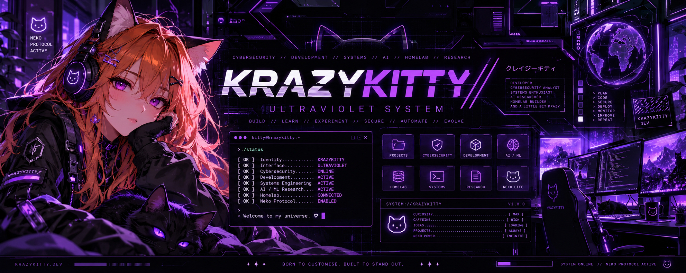
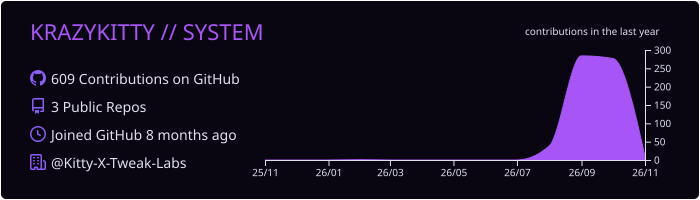
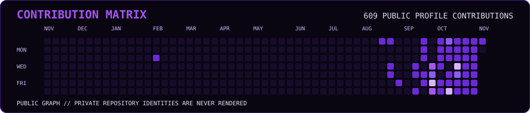
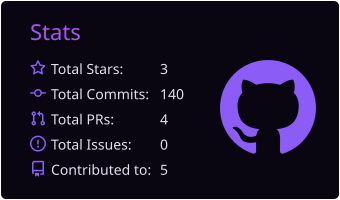
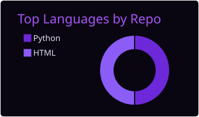
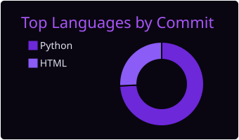
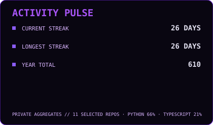

  

  # 💜 KRAZYKITTY // DEVELOPMENT UNIVERSE

  **SYSTEMS • SECURITY • INFRASTRUCTURE • AI**

  **Computer Science Student · Cybersecurity Analyst · Python Developer**

  *Born to customise. Built to stand out.*

  
  
  

  **[ CURIOSITY ENABLED ] · [ ALWAYS LEARNING ] · [ NEKO PROTOCOL ACTIVE ]**

---

## 01 // WHOAMI 🐱

Hi! I'm **Kitty**, also known as **KrazyKitty**, a Computer Science student and developer based in Ireland. I focus on the intersection of **defensive cybersecurity, software engineering, systems architecture, automation and AI/ML research**.

I enjoy understanding technology from the inside out: how systems work, where they fail, how to secure them and how to build better ones. My projects range from Python tools and experimental language models to Linux infrastructure and developer-focused software.

My long-term direction is to design **secure, resilient systems** and build original software and AI technology. This GitHub profile documents that process — including experiments, working systems and ideas that are still taking shape.

~~~text
kitty@krazykitty:~$ whoami

IDENTITY      KrazyKitty
LOCATION      Ireland
FOCUS         Systems | Security | Infrastructure | AI
CORE          Python | Linux | Automation | Research
PHILOSOPHY    Build. Test. Document. Learn. Improve.

> Welcome to my development universe. 💜
~~~

## 02 // ENGINEERING FOCUS ⚡

| Domain | What I work on |
|:--|:--|
| 🛡️ **Cybersecurity** | Defensive security, system hardening, secure development, authentication, monitoring and threat awareness |
| ⚙️ **Systems & Infrastructure** | Linux administration, containerised services, homelab operations, observability and automation |
| 💻 **Software Engineering** | Python development, web tooling, APIs, testing, CI/CD and maintainable architecture |
| 🧠 **AI / ML Research** | From-scratch Transformers, tokenisation, training and evaluation pipelines, inference and reproducibility |
| 🐈 **Developer Experience** | Custom tooling, interfaces, plugins, documentation and accessible, expressive design |

## 03 // TECHNICAL ARSENAL 🧰

**Programming & application development**

**Security, operating systems & infrastructure**

**AI research & development tools**

*These are technologies I work with or study, not a claim of equal proficiency in every tool.*

## 04 // FEATURED BUILDS & RESEARCH 🚀

### Public repositories

| Project | Description | Current stage |
|:--|:--|:--|
| 🧠 **[KittyLM](https://github.com/krazykitty2503/KittyLM)** | Independent language-model research: decoder-only Transformers, tokenisation, training, inference, evaluation and reproducible experiments | Experimental research |
| 🌐 **[KrazyKitty.dev](https://github.com/krazykitty2503/KrazyKitty.dev)** | Public portfolio and KRAZYKITTY // ECOSYSTEM website, built with semantic HTML, CSS and vanilla JavaScript | Active development |

### Selected private engineering projects

| System | Focus | Stage |
|:--|:--|:--|
| ⚙️ **KRAZY//NEXUS** | Secure control-plane architecture, APIs, access controls and auditable automation | Pre-alpha development |
| 💜 **KRAZY//CORD** | Custom Equicord plugin development and developer tooling | Active development |
| 🐧 **KERNEL//KITTY** | Self-hosted Debian infrastructure, services, security and observability | Operational homelab; evolving |
| 📡 **KERNEL//SENTINEL** | Raspberry Pi 400 monitoring and operations console | Hardware/setup stage |
| 🤖 **KITTY//RELAY** | Telegram-based developer and AI automation | Development |
| 🐈 **KITTY//LINUX** | Exploration of a custom Linux distribution | Long-term plan |

**Project visibility matters:** Private projects are described at a high level. A listed project is not necessarily publicly released, production-ready or independently verified.

### The bigger picture

**KRAZYKITTY // DEVELOPMENT UNIVERSE** is my overarching portfolio and engineering journey.

- **KRAZYKITTY // ECOSYSTEM** — the public-facing presentation of my work.
- **KITTYS//ECOSYSTEM** — the technical ecosystem and connected engineering projects.
- **KRAZY//NEXUS** — the evolving control-plane project.
- **KittyLM** — foundational language-model research.

## 05 // GITHUB TELEMETRY 📊

  
  
  
  
  
  

  Statistics are generated by the repository's GitHub Actions workflow. Private repository names are not displayed. See <a href=".github/PROFILE_STATS.md">statistics methodology</a>.

## 06 // HOMELAB & SYSTEMS LAB 🖥️

I use a personal lab to practice practical systems engineering, secure configuration, Linux administration, networking and infrastructure reliability.

- **KERNEL//KITTY:** Debian-based home server with containerised applications, monitoring and infrastructure tooling.
- **KERNEL//SENTINEL:** Raspberry Pi 400 project for a dedicated homelab monitoring and operations console.
- **Workstation lab:** Windows, Linux, virtual machines and development environments for testing and experimentation.

My approach is to **design conservatively, test changes, document decisions and keep security boundaries explicit**. Public descriptions deliberately exclude credentials, private network details and sensitive deployment configuration.

## 07 // CURRENT DIRECTION 🧭

- [x] Build and operate a Debian homelab
- [x] Establish a public portfolio and independent language-model research repository
- [x] Build foundations for custom development and automation ecosystems
- [ ] Keep improving defensive-security tooling, engineering practices and documentation
- [ ] Advance controlled KittyLM experiments and reproducible evaluation
- [ ] Expand secure infrastructure automation and observability
- [ ] Develop KERNEL//SENTINEL into a dedicated monitoring console
- [ ] Explore custom Linux systems and deeper systems architecture

**My engineering loop:** Research → Design → Build → Test → Secure → Document → Improve.

## 08 // CONNECT & COLLABORATE 🌐

I'm interested in **cybersecurity, software engineering, systems architecture, AI research and interesting technical collaborations**.

---

### 💜 STILL LEARNING // STILL BUILDING // STILL EVOLVING

**KRAZYKITTY — BORN TO CUSTOMISE. BUILT TO STAND OUT.**

🐱 [ SYSTEM ONLINE ] // [ NEKO PROTOCOL ACTIVE ] // [ CURIOSITY: INFINITE ]

